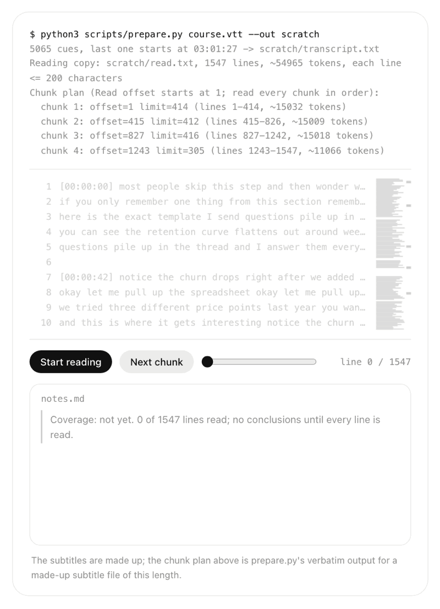
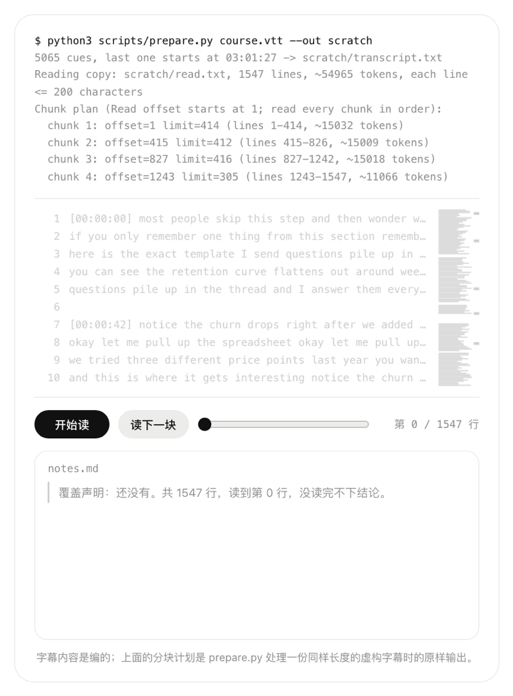

# skills

skills is a public collection of agent skills for Claude Code that I use daily and have hardened on real work. Each one is a folder with a `SKILL.md`, usable from Claude Code as `/name`.

<a href="https://max1874.com/skills/"></a>

<sub>A recorded demo from [max1874.com/skills](https://max1874.com/skills/), where you can try it yourself.</sub>

[中文说明](#中文说明)

## deep-read

**Makes an agent read a long source to the end, prove it, and actually understand what it says.**

Hand an agent a 3-hour transcript and it will usually read part of it — a single read tops out at ~25k tokens, a paragraph-per-line transcript can't be chunked, the first 2000 lines are the default cap, or it just greps and summarizes — and then hand you a summary that *looks* complete. `deep-read` fixes the workflow:

1. A script turns the source (SRT/VTT subtitles, text, extracted PDF) into a reading copy with short lines and a chunk plan that fits the read limit, estimated per language (CJK text costs ~4x the tokens of English per character).
2. The agent reads every chunk in order, itself — no subagent summaries, no sampling.
3. Notes are written after each chunk, so progress survives context compaction.
4. Once every line is read, the notes open with **what it is saying**: the main point, how the parts build it, where it is strong or weak, and what is worth taking away. How hard to fact-check depends on the kind of source: a speech is read for its meaning, a market call for its evidence. The notes end with a coverage line (file, line count, each chunk's range).
5. A second agent reads the source from scratch without seeing the notes and writes its own understanding; every disagreement is checked against the source. It catches what the first reader is anchored against, like a host's summary recorded as the guest's view.

On a 3-hour YouTube course (~41k words), this surfaced what a skim would miss: `$6.41` transcribed as `$641`, a community size stated two different ways, and two "I'll explain later"s that never came.

**How it differs from similar skills**

- [full-output-enforcement](https://skills.sh/leonxlnx/taste-skill/full-output-enforcement) stops agents from *writing* less than asked. `deep-read` stops them from *reading* less than given.
- [dsh-deepread](https://github.com/xiehuan123/dsh-deepread) and the "deep reading" framework skills apply an *analysis* template (claims, evidence, mental models). `deep-read` makes every line read, with proof, the floor, and asks for understanding in the source's own terms on top of it.
- Research skills that delegate reading to a background agent trade completeness for speed. `deep-read` makes the opposite trade on purpose.

### Install

```bash
npx skills add max1874/skills --skill deep-read
```

Or copy the `deep-read/` folder into `~/.claude/skills/` (all projects) or `.claude/skills/` (one project). Then use `/deep-read`, or just ask the agent to read something thoroughly.

Requirements: Python 3 (standard library only). For PDFs, `pdftotext` from poppler.

## FAQ

**How do I make Claude Code read a long document or transcript all the way through?**
Install `deep-read`, then run `/deep-read` or ask it to read everything without skipping. The script builds a short-line reading copy and a chunk plan; the agent reads and takes notes chunk by chunk, and finishes with notes that open with what the source is saying and end with a coverage line listing the lines each chunk covered.

**Why does Claude Code only read part of a long file?**
A single read errors above ~25k tokens, Read returns the first 2000 lines by default, a paragraph-per-line transcript can't be split by line, or the agent greps and summarizes instead of reading. `deep-read`'s script and rules target each of these.

**How do I install a Claude Code skill?**
`npx skills add max1874/skills --skill deep-read`, or copy the skill's folder into `~/.claude/skills/` (all projects) or `.claude/skills/` (one project). Then call it with `/name`.

**Does it work with Codex or other agents?**
Each skill is a standard `SKILL.md` folder, and `npx skills add` can install it for other agents (`-a codex`). `prepare.py` runs from any agent with a shell, but the reading steps (offset/limit, `pages`, the read-size limit) are written for Claude Code's Read tool.

**Can it read subtitles and PDFs?**
SRT/VTT become timestamped paragraphs. PDFs with a text layer go through `pdftotext -layout` first; scanned PDFs are read in page order with Read's `pages` parameter, up to 20 pages at a time.

More: [max1874.com/skills](https://max1874.com/skills/)

---

## 中文说明

skills 是一组公开的 Claude Code agent skill，都是我日常在用、在真实任务里打磨过的。每个 skill 是一个带 `SKILL.md` 的文件夹，在 Claude Code 里用 `/名字` 调用。

<a href="https://max1874.com/skills/"></a>

<sub>动图录自 [max1874.com/skills](https://max1874.com/skills/)，那里可以亲手试。</sub>

### deep-read：让 agent 真的把长材料读完、证明读完了，并且读懂

把一份 3 小时的转写稿交给 agent，它通常只读了一部分就给出一份看起来完整的总结。原因有几种：单次读取超过约 2.5 万 token 会报错；一段一行的转写稿没法按行切块；默认只读前 2000 行；或者干脆 grep 几下就开始总结。`deep-read` 把读的流程固定下来：

1. 用脚本把原文（SRT/VTT 字幕、纯文本、从 PDF 抽出的文字）折成短行，并按估算的 token 数给出分块计划。中文每个字的 token 成本约是英文字符的 4 倍，脚本会分语言估算。
2. agent 自己按顺序读完每一块，不交给子 agent 总结，也不抽样。
3. 每读完一块就写笔记，上下文被压缩也不丢进度。
4. 全部读完后，笔记开头先写**它在说什么**：主旨、各部分怎么把它说出来、哪里有力量哪里站不住、值得带走什么。事实核对做多少看材料类型：演讲读的是意思，行情判断查的是依据。笔记末尾一行写明读了哪个文件、多少行、每块的行号范围。
5. 另一个 agent 不看笔记，从头独立读一遍，写出它自己的理解；每一处分歧都回原文核对。

实测一门 3 小时的 YouTube 课程（约 4.1 万词），读出了略读发现不了的问题：字幕把 `$6.41` 识别成 `$641`，社群规模前后说法不一，两处「后面再解释」最后都没解释。

**和同类的区别**：[full-output-enforcement](https://skills.sh/leonxlnx/taste-skill/full-output-enforcement) 防止 AI 写得比要求的少，`deep-read` 防止 AI 读得比给的少；[dsh-deepread](https://github.com/xiehuan123/dsh-deepread) 等「深度阅读」类 skill 套分析框架，`deep-read` 以读全、留证据为底线，在此之上按材料本身读懂它。

**安装**：`npx skills add max1874/skills --skill deep-read`，或者把 `deep-read/` 文件夹复制到 `~/.claude/skills/`。需要 Python 3；处理 PDF 需要 poppler 里的 `pdftotext`。

### 常见问题

**怎么让 Claude Code 把一份长文档或转写稿完整读完？**
装上 `deep-read`，用 `/deep-read`，或者直接说「全部读完，别跳」。脚本先生成短行阅读副本和分块计划，agent 逐块读、逐块写笔记，最后的笔记开头写它在说什么，末尾一行写明每块读了哪些行。

**为什么 Claude Code 读长文件只读了一部分？**
单次读取超过约 2.5 万 token 会报错；Read 默认只返回前 2000 行；一段一行的转写稿没法按行切块；或者 agent grep 几下就开始总结。`deep-read` 的脚本和规则针对的就是这几种情况。

**怎么安装 Claude Code 的 skill？**
`npx skills add max1874/skills --skill deep-read`，或者把 skill 文件夹复制到 `~/.claude/skills/`（所有项目）或 `.claude/skills/`（单个项目），然后用 `/名字` 调用。

**能用在 Codex 或其他 agent 上吗？**
每个 skill 是标准的 `SKILL.md` 文件夹，`npx skills add` 可以装给其他 agent（`-a codex`）。`prepare.py` 在任何能跑命令的 agent 里都能用，但读取步骤（offset/limit、`pages`、读取上限）是按 Claude Code 的 Read 工具写的。

**能读字幕和 PDF 吗？**
SRT/VTT 会转成带时间戳的段落。有文字层的 PDF 先用 `pdftotext -layout` 转成文本；扫描版用 Read 的 `pages` 参数按页序读，每次最多 20 页。

更多：[max1874.com/skills](https://max1874.com/skills/)
